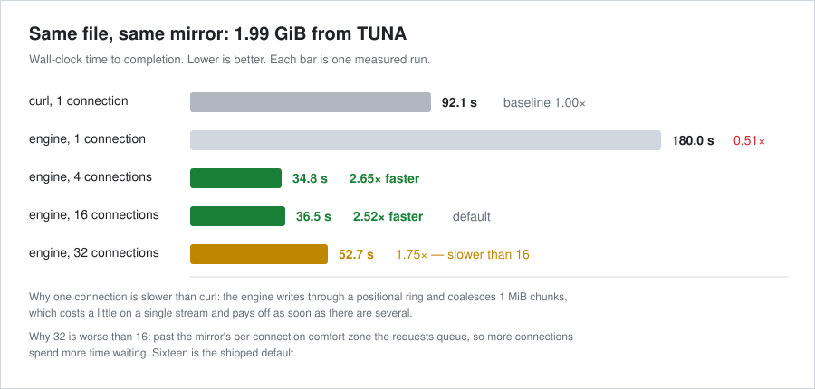
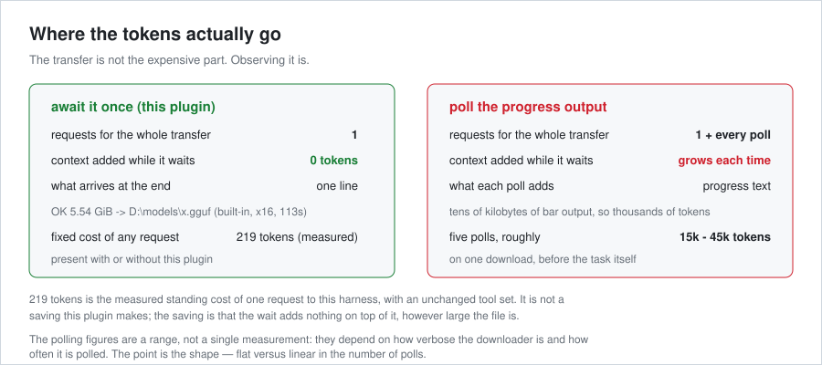
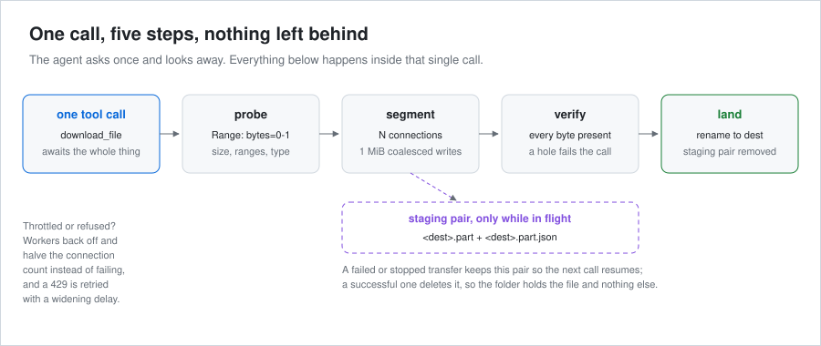

# dsh-download

**Faster downloads for your agent — and free to watch.**

One `download_file` call does the whole job. The built-in engine splits the file across parallel
connections (measured **2.5× faster** than a single `curl` connection on the same mirror), resumes
what a dropped connection or a restart interrupted, verifies every byte, and leaves the file exactly
where you asked for it — nothing else. Because the transfer is awaited inside that one call,
**watching it costs no tokens**: the tool returns a single line. Progress stays visible in a panel
under **Settings → Plugins** without entering the model context.

**Neat Download Manager stays optional** — it is there to be selected instead, not to be installed
first.

> 中文简介：[INTRODUCTION.md](./INTRODUCTION.md) · 在别的机器上安装：[INSTALL.md](./INSTALL.md)

## Measured, not asserted



*Same file, same mirror, wall-clock time. Four to sixteen connections were 2.5–2.7× faster than one
`curl` connection; thirty-two was **slower** than sixteen, which is why sixteen is the default.*



*Awaiting the call keeps the context flat. Polling a progress bar does not.*



*What happens inside that single call — including the staging pair that makes a resume possible, and
that a successful transfer removes.*

## The problem it solves

Downloading a multi-gigabyte file inside a tool call is expensive for one reason: **how the
progress is observed**, not the transfer itself. Reading a downloader's progress output injects
tens of kilobytes of progress-bar text into the model context, and polling it repeatedly
multiplies that cost. A single 5.9 GB download polled a few times can burn more tokens than the
entire surrounding task.

This plugin removes the problem structurally:

| Mechanism | Effect |
| --- | --- |
| The tool declares **no `timeoutMs`** | The harness imposes no tool-call deadline, so the whole transfer is awaited inside one `execute()` call. Waiting inside a tool call is free — only the returned value enters context. |
| The result is **one short string** | `OK 5.54 GiB -> C:\...\file.gguf (NDM task 199, 252s)` |
| Failures return in the **same call** | `FAIL NDM task 203: Error Occurred. No Internet Connection or DNS Failed.` — no polling to discover a problem. |
| A **prompt section** steers the model | Downloading via `curl`/`wget`/`Invoke-WebRequest` is discouraged in favour of this tool. |

## Two engines

The tool ships two interchangeable download engines, selected by the `engine` setting. The
user-facing contract is identical either way: the file ends up at the requested destination, at
the expected size, and the result path is true.

| | **Built-in** (`engine: "builtin"`, default) | **Neat Download Manager** (`engine: "ndm"`) |
| --- | --- | --- |
| Install | Nothing to install — it is part of this plugin | Requires Neat Download Manager on Windows |
| Destination | Stages in `<dest>.part` and takes the destination name when complete (see *Resuming* below) | Downloads into its own folder, then the plugin moves the file and verifies the move |
| User-Agent | Chosen by the plugin (`curl/8.21.0`, rotating on 403) | Neat Download Manager's own setting (registry `DefaultAgent`) |
| Blocked mirrors | **Reaches them** — mirrors that refuse browser spoofing serve this engine | Needed a registry change to `DefaultAgent` before those mirrors worked |
| Throttling | **Halves concurrency automatically** on 418/429 | Fixed connection count |
| Progress window | None | **Yes** — visible in its own window |
| Resume | **Yes** — a second call continues from disk (URL, size and validators checked) | Yes, in its own task |
| Measured speed | **4.44 GiB in 113 s (≈40 MiB/s, 16 connections)**; 75 s in an earlier run on a less busy mirror | 4.44 GiB in 146 s (≈31 MB/s, 32 connections) |
| Disk behaviour | Positioned writes into preallocated space; no segment files, no merge step | Writes `seg.xN` files and merges them; abandoned tasks leave those behind |
| Bad responses | Validated **before** writing, so an error page never becomes a file | Writes whatever it receives |
| Portability | Any OS Node runs on | Windows only |
| Maturity | New, and reviewed only by its own tests | Years of handling odd servers, proxies and redirects |

### Risks of each, stated plainly

**Built-in engine** — it is new code, so it has the bug surface of new code. It handles standard
HTTP range downloads and falls back to a single stream when the server does not support ranges,
but it has not met the long tail of malformed servers that Neat Download Manager has. Its
correctness rests on three checks now: the written length must equal the declared length; a test
asserts that a parallel-written file is byte-identical (sha256) to a single-stream one, so a
segment written at the wrong offset cannot pass; and a resume is used only against a state file
that proves it describes the same resource. Where it is still behind Neat Download Manager is
experience, not throughput: measured on the same mirror it is the faster of the two. Switch to
`engine: "ndm"` if a particular server defeats it, or if you want a progress window outside the
browser.

**Neat Download Manager** — mature and fast, with a progress window. But it is an external Windows
program that must be installed, it decides its own User-Agent (several Chinese university mirrors
answer 403 or an HTML error page to its browser-spoofing default), and it always saves into its own
directory, so a requested destination means downloading elsewhere and moving the file afterwards.
Its settings are cached at startup, so registry changes need a restart to take effect. It also
accumulates `seg.xN` data under `%APPDATA%\NeatDM` for abandoned tasks — measured at 4.3 GB after
months of use.

Both engines are kept deliberately. Neither is a fallback in name only: switching `engine` is the
entire migration.

### Permissions

Both engines need **unrestricted file access** — the tool works outside the session workspace by
design, since a download destination usually is not the project folder:

- **Built-in**: writes the destination path, which may be anywhere on any drive.
- **NDM**: starts `NeatDM.exe`, reads its task directory under `%APPDATA%\NeatDM`, and **moves the
  finished file across directories or volumes**.

Under a sandboxed or read-only policy the tool cannot do its job and will report a failure from the
move rather than silently leaving the file elsewhere. Relocating the settings file
(`~/.dsh/dsh-download.settings.json`), reading the Neat Download Manager registry key
(`HKCU\Software\NeatDM`), and restarting Neat Download Manager are all outside-workspace operations
too.

## Routing

The tool probes the URL's size (HEAD, falling back to a one-byte ranged GET) and then:

- **size ≥ 1 GiB** → handed to Neat Download Manager (`NeatDM.exe <url>`), which downloads with
  multiple connections and shows progress in its own window. The tool watches
  `%APPDATA%\NeatDM\<id>\LogFile.txt` for Neat Download Manager's terminal engine state, verifies
  the finished file on disk, and waits for its size to stop growing.
- **size < 1 GiB** → downloaded directly in-process, so small files are not slowed by the handoff.

If the size cannot be determined, the direct path is used and the result says so; pass
`force: true` routes through Neat Download Manager regardless — including when the `engine` setting
says `builtin`, so it works as a per-call override without changing the machine-wide setting.

## Tool arguments

| Argument | Required | Meaning |
| --- | --- | --- |
| `url` | yes | The HTTP(S) URL to download. |
| `dest` | no | Destination file path or directory. Omitted → the file stays where the downloader put it. |
| `force` | no | Route through Neat Download Manager even below the size threshold. |
| `waitSeconds` | no | Cap the wait. Omit to wait until the transfer finishes; set a small value to stop early and continue later. Applies to **both** engines, and with the built-in engine stopping is cheap: partial work is kept and resumed. |
| `mirrors` | no | Other URLs carrying **the same file**. Ranges are spread across all of them, which is what helps when a single host is the ceiling. See below. |

Returns exactly one of:

```
OK <size> -> <path> (direct)
OK <size> -> <path> (built-in, segmented x16, resumed from 43%, 21s)
OK <size> -> <path> (NDM task <id>, <seconds>s)
TIMEOUT still downloading: built-in engine reached 879.00 MiB of 1.99 GiB in 15s.
        A partial transfer is kept at <path>.part; call download_file again with the same dest to resume it.
TIMEOUT still downloading: NDM task <id>, <size> received so far.
FAIL <reason>
```

## Many mirrors, one file

A single host caps a transfer twice: **per connection**, and **per mirror** — a server-side limit no
number of connections gets past. Spreading ranges across several mirrors that carry the same file
gets past the second cap, and that is the only lever that works when the host itself is the ceiling.

```
download_file(url: "https://mirror-a/…/model.gguf",
              mirrors: ["https://mirror-b/…/model.gguf",
                        "https://mirror-c/…/model.gguf"],
              dest: "D:/models/model.gguf")
```

**Every mirror has to prove it serves the same bytes before a single range is trusted to it.** Mixing
two builds yields a file that passes every later check — right size, every segment "complete" — while
containing bytes from two different files, so the check happens first and is not optional:

1. the declared size must equal the primary's, exactly;
2. three 32 KiB windows — start, middle, and end — are fetched from the primary **and** the candidate
   and hashed; all three must match. The middle window is what catches a rebuild that keeps its
   header.

A mirror that fails either test is **refused and named in the result**, never used and never silently
ignored:

```
OK 5.88 GiB -> D:\models\model.gguf (built-in, segmented x16, 2 mirrors, resumed from 12%, 118s)
FAIL … sources refused: mirror-c: bytes at offset 4177920 differ from the primary
```

What this does **not** do: it does not mix different files, it does not help when your own line is the
limit (16 connections already could not beat that), and it is not a substitute for a checksum when you
have one. Costs: one probe plus three small requests per mirror before the transfer starts, and a
mirror that keeps failing is dropped from the rotation after two strikes — the first URL always stays
as the fallback.

## Resuming an interrupted download

A transfer that stops — a dropped connection, a bounded `waitSeconds`, a restarted dsh — does not
throw its work away. The next call with the same `dest` continues from the last byte that reached
disk.

How it works, and why it is safe to trust:

- The transfer works on **`<dest>.part`**, and the destination name appears only once every segment
  is proven complete. This matters because the file is preallocated to its final size: without
  staging, a half-finished transfer would have exactly the right name and exactly the right size
  while being full of holes — indistinguishable from a finished file, even after a hard kill.
- Progress lives in **`<dest>.part.json`**, written atomically and refreshed at most every couple of
  seconds (always when a segment completes).
- **Nothing recorded is taken on faith.** A resume is used only when the state names the same
  destination, the same URL and the same size, and — when the server supplies them — the same ETag
  or `Last-Modified`. A conflict is decisive; anything unverifiable starts over rather than splicing
  bytes from two different files together, which would produce a file of the right size that is
  quietly corrupt. The parts recorded in the state, not a freshly computed split, define the
  segments, so progress survives a change to `builtinConnections` in between.
- On success both files go away, and the staged file takes the destination name. There is no
  residue, ever.
- **A partial nobody could resume is not kept.** If no bytes arrived, or the state file is missing
  or unreadable, there is nothing to continue — so the staged file is removed rather than left in
  the folder wearing the destination's name. A `.part` with no `.part.json` beside it is likewise
  swept on the next start, whatever its age.
- **A pair that is still resumable is kept for `partialRetentionDays`** (7 by default) and swept
  after that. Set it to `0` to keep no partial at all: a stopped transfer then leaves nothing
  behind and simply cannot be resumed.

What a dropped connection does, precisely, because it is the case that matters:

| Situation | What happens |
| --- | --- |
| The network returns during the same call | The worker retries with backoff and continues from the byte it stopped at. No failure, nothing deleted. |
| The call gives up after exhausting retries | The partial and its state are **kept** (if any bytes arrived) and the result names them. Calling again continues; it does not start over. |
| dsh is killed or the machine loses power | No code of ours runs, so nothing is deleted. The next call resumes. |
| You call again while the server is still unreachable | The failure happens at inspection, before any file is touched, so the existing partial survives untouched. |
| `waitSeconds` expires | Kept, exactly like any other interruption — that is what makes a bounded wait useful. |

Measured on a real 1.99 GiB ISO from a domestic mirror: a bounded 15-second wait left 879 MiB
(43%) on disk, and the follow-up call finished the remaining 57% in 21 s with a sha256 matching the
mirror's published sum.

What resume cannot promise: bytes counted as written are the bytes handed to the operating system,
not bytes a hard power cut could not have lost. A process interruption is resumable; a power failure
during a transfer is not guaranteed to be. If in doubt, hash the result.

## Requirements

- **Neat Download Manager** installed, **only for the Neat Download Manager engine**. The built-in
  engine, which is the default, needs nothing installed at all. The path is auto-detected from
  `D:\Neat Download Manager\NeatDM.exe`, the two `Program Files` locations, then `PATH`.
- Node.js 18+ (for `fetch` and `Readable.fromWeb`). dsh's own runtime satisfies this.

No npm dependencies: Node builtins only, and no dsh package imports. That is deliberate — it
means the same folder works on any dsh version, which is what makes it portable.

## Install

This machine already has it installed. The command, for any machine:

```powershell
dsh plugin --profile web add "<path-to-this-folder>"
```

That forwards to pnpm in the profile directory and then reconciles
`dsh.profile.bundles`, so this folder joins the profile's bundle layer stack. The row is
composed **before** the user patch layer, which is why `cordis.patch.yml` — a boot-critical
file — is never touched.

Verify the row composed:

```powershell
dsh --profile web --dump-config | Select-String -Pattern "ndm" -Context 2,2
```

**A dsh restart is required** for the new bundle layer to be read; the tool appears in
sessions started afterwards.

### Moving to another machine

1. Copy the whole `dsh-download` folder anywhere (a USB stick, a repo, another disk).
2. Install Neat Download Manager, run it once, and enable its browser integration.
3. Run the install command above, pointing at the copied folder.
4. Restart dsh.

Nothing in the folder is machine-specific: paths are auto-detected and every setting has a
portable default.

## Guaranteeing the destination

Neat Download Manager downloads into its own configured directory and **has no command-line
option to change that** — its settings live in `HKCU\Software\NeatDM`, and it reads them once at
startup rather than per download (verified: changing `DownloadDirectory` while it runs has no
effect on where the next file lands). So the only way to put a file somewhere specific is to move
it afterwards, and the plugin does that as part of the contract:

- **Passing `dest` forces monitoring on.** There is nothing to move until the transfer finishes,
  so "put it at A" and "don't wait" cannot both hold. When this override happens the result says
  so: `(monitoring forced on to honour dest)`.
- **The move is verified, not assumed.** The destination must exist at the expected size and the
  source must be gone. A failure returns `FAIL download finished but ...` — the tool never reports
  a path it did not actually write to.
- **Leftovers are cleaned.** The plugin's own `*.part` staging files, and every error or
  interstitial page the download produced, are removed. Candidates must be *fresh*, *name-shaped
  like the expected file*, and *of a disagreeing size* — all three — so a genuine file of the
  right size is never touched, and neither is a neighbour such as `image.iso.sha256`.

### The `monitor: "none"` caveat

With `monitor: "none"` and no `dest`, the tool hands the URL over and returns immediately. It
therefore **cannot know whether the download succeeded, and cannot clean anything up** — the call
is already over. That is inherent to fire-and-forget, not a defect: you get zero waiting and zero
verification. Use it when you are watching Neat Download Manager's window yourself; use the
default blocking mode when the outcome has to be guaranteed.

## Settings

Settings live in a JSON file that is **re-read on every download**, so an edit takes effect on
the next transfer with **no dsh restart**:

```
%DSH_HOME%\dsh-download.settings.json          default: C:\Users\<you>\.dsh\dsh-download.settings.json
```

The plugin writes it with documented defaults the first time it loads, and **never overwrites an
existing file**. Delete any key to fall back to its default.

| Key | Default | Meaning |
| --- | --- | --- |
| `engine` | `"builtin"` | Which engine downloads: `"builtin"` needs nothing installed and writes straight to the destination; `"ndm"` uses Neat Download Manager. |
| `builtinConnections` | `16` | Parallel connections used by the built-in engine. |
| `thresholdBytes` | `1073741824` (1 GiB) | Size at or above which a download is routed through Neat Download Manager. For the built-in engine it is the size at which full parallelism kicks in. |
| `monitor` | `"block"` | `"block"` waits for the transfer and reports the outcome. `"none"` hands the file to Neat Download Manager and **returns at once** — no waiting, no polling, progress visible only in its own window. |
| `pollIntervalMs` | `1500` | How often the task log is checked while monitoring. |
| `stallTimeoutMs` | `120000` | Give up on a monitored task after this long with no byte movement. |
| `taskAppearTimeoutMs` | `45000` | How long to wait for Neat Download Manager to open a task for the URL. |
| `settleMs` | `4000` | How long a finished file must stop growing before it counts as complete. |
| `ndmPath` | auto-detect | Full path to `NeatDM.exe`. Checked before the built-in candidate list. |
| `downloadDir` | `%USERPROFILE%\Downloads` | Directory Neat Download Manager saves into. |
| `taskRoot` | `%APPDATA%\NeatDM` | Neat Download Manager task directory. |
| `uiPollIntervalMs` | `1000` | How often the download panel refreshes **while its tab is displayed**. It costs nothing when the tab is closed, because the panel stops polling entirely. |
| `partialRetentionDays` | `7` | How long an interrupted download may keep its `<dest>.part` and `<dest>.part.json` before they are swept at the next start. `0` keeps no partial at all: a stopped transfer removes everything immediately and cannot be resumed. |

Example — route anything over 4 GiB through the downloader, check progress every 5 seconds:

```json
{
  "thresholdBytes": 4294967296,
  "pollIntervalMs": 5000
}
```

Example — fire and forget, never wait:

```json
{
  "monitor": "none"
}
```

With `monitor: "none"` the result reports the destination up front, so a caller still learns
where the file is going without waiting for it:

```
STARTED NDM task 223 -> expects C:\Users\<you>\Downloads\image.iso (4.44 GiB).
Monitoring is off; it continues in Neat Download Manager.
```

A malformed settings file does **not** break downloads: the problem is reported as a `WARNING`
prefix on the result and the defaults are used.

### Or use the wizard

Editing JSON is fine for a settings file you already know about. For everyone else there is
**`settings.cmd`** — double-click it for a menu:

```
  多大的文件才走分段下载 : 1 GB
  下载时是否等待         : 等待完成并返回结果 (默认)
  监视间隔               : 1500 毫秒
  NeatDM.exe 路径        : 自动探测
  完成文件保存目录       : C:\Users\<you>\Downloads (默认)

    1) 修改「多大的文件才走分段下载」
    2) 修改「下载时是否等待完成」
    3) 修改「监视间隔」
    4) 修改 NeatDM.exe 路径
    5) 修改 完成文件保存目录
    6) 查看设置文件原文
    7) 恢复默认设置
    0) 退出
```

It changes nothing until you pick a number, touches nothing in dsh, and can be deleted at any
time — the plugin does not depend on it. It is simply the discoverable front door to the file.

Threshold choices are human-sized (`100 MB`, `1 GB`, `4 GB`, or type `1.5GB` yourself), plus two
extremes: *all downloads through Neat Download Manager* and *never use it*.

### Three encoding traps in this folder

All three cost real debugging time, so they are written down:

- **`*.cmd` files must keep CRLF line endings and stay ASCII-only.** `cmd.exe` misparses an
  LF-only batch file — it stops honouring `@echo off` and `REM` and begins executing comment text
  as commands. All Chinese text therefore lives in the `.ps1` files.
- **The `.ps1` files are UTF-8 *with a BOM*.** Without the BOM, PowerShell 5.1 decodes them as the
  OEM code page and the Chinese menus become mojibake. `chcp 65001` in the `.cmd` wrapper makes
  them render.
- **The settings JSON must be written *without* a BOM, and read tolerantly of one.** Windows
  Notepad saves UTF-8 with a BOM by default, and so does PowerShell's
  `Set-Content -Encoding UTF8`, while JavaScript's `JSON.parse` rejects a leading `U+FEFF`. This
  was a live defect, not a hypothetical: the wizard used `Set-Content`, so the settings file it
  produced could not be read by the plugin at all, and any user editing the file in Notepad would
  have silently lost every setting. The plugin now strips a leading BOM before parsing, and the
  wizard writes with `UTF8Encoding($false)`. `test-ndm-settings.mjs` covers the BOM case.

### Why a file and not a settings page

dsh does expose settings slots (`settings.section`, `settings.plugins.tab`), but its plugin
configuration UI uses hand-written controls for specific shipped plugins, and a client-side
panel would mean shipping React code that can only be verified in a browser. A JSON file plus a
console wizard delivers the same accessibility with none of that risk, and neither one can break
the dsh interface.

## Environment overrides

Environment variables still work and are used when a settings key is absent, so an
environment-only setup keeps working untouched:

| Variable | Default |
| --- | --- |
| `DSH_NDM_PATH` | auto-detected `NeatDM.exe` |
| `DSH_NDM_DIR` | `%USERPROFILE%\Downloads` |
| `DSH_NDM_THRESHOLD` | `1073741824` (1 GiB) |
| `DSH_NDM_TASKROOT` | `%APPDATA%\NeatDM` |
| `DSH_NDM_POLL_MS` | `1500` |
| `DSH_NDM_STALL_MS` | `120000` |
| `DSH_NDM_APPEAR_MS` | `45000` |
| `DSH_NDM_SETTLE_MS` | `4000` |

Precedence is **environment variable → settings file → built-in default**.

The environment comes first, and it has to: the plugin writes a settings file containing every
numeric key the first time it loads, so with the file first these overrides are silently inert on any
machine that has ever run it. That was the case until it was measured — `DSH_NDM_THRESHOLD` and five
of its siblings did nothing at all (`probe-env-overrides.mjs` is the measurement). Note also that
`engine` and `monitor` have **no** environment override; they are file-only.

`DSH_NDM_DIR` matters: Neat Download Manager saves into its own configured directory, so if you
have pointed it somewhere other than `Downloads`, set this or the plugin will report that no
finished file appeared.

## Download status (the data layer for a progress UI)

Every download is recorded, live, in:

```
%DSH_HOME%\dsh-download.status.json       default: C:\Users\<you>\.dsh\dsh-download.status.json
```

```json
{
  "version": 1,
  "updatedAt": "2026-09-21T13:35:56.572Z",
  "active": [ { "id": "…", "url": "…", "dest": "…", "engine": "built-in",
                "state": "downloading", "bytes": 536870912, "total": 4762707968,
                "percent": 11.2, "speedBps": 63200000, "method": "segmented",
                "connections": 16 } ],
  "recent": [ { "state": "completed" },
              { "state": "failed", "error": "HTTP 403 on inspection",
                "hint": " the server refused the request" },
              { "state": "interrupted",
                "error": "the download did not finish: dsh restarted while it was in flight" } ]
}
```

`active` holds the transfers in flight, with byte count, declared total, percentage, a derived speed
and the connection count — everything a progress bar needs. `recent` holds finished ones, each with
its outcome and, for a failure, the reason and the same hint the tool would have returned. A
cancellation is its own state, never a failure.

Why a file rather than a live API: this is the foundation either way. The panel inside dsh reads the
same registry over a host route, a viewer outside dsh can open the file directly, and a person can
read it in a text editor. It is written atomically — temporary sibling, then rename — so a reader
never sees a half-written document, and only the newest entries are kept so it cannot grow without
limit.

Four properties are deliberate:

- **It costs nothing.** The registry never touches the model context; the tool still returns one
  short line. This is a side channel, so progress is visible at no extra token cost.
- **It cannot break a download.** Every write is best-effort. A read-only home directory, a locked
  file, or an impossible path is swallowed — status recording is never allowed to fail a transfer.
- **It is bounded and self-cleaning.** Finished entries are trimmed to the newest 25.
- **It survives a restart.** On startup the registry adopts the file's history, so the panel does
  not start blank after every restart. An entry the previous process still called in flight is
  re-recorded as `interrupted` — it did not finish, and calling it live would be a row that never
  resolves — and the reconciled document is written back so any other reader agrees.

## The download panel

**Settings → Plugins → 下载.** A tab, not a floating window: it exists only where someone is
already looking, and it disappears with the settings dialog. While the tab is not displayed it does
**nothing at all** — no timer, no request, no disk read. A visited tab stays mounted but hidden, so
the panel watches its own visibility with an `IntersectionObserver` (plus the document's
`visibilitychange`) rather than assuming that mounting means being looked at.

It shows:

| Area | Contents |
|---|---|
| In flight | filename, progress bar, `bytes / total`, speed, engine, connection count, elapsed time, destination path with a copy button |
| Recent | one row per finished download: outcome, size, engine, connection count, how it was carried out, duration, time — and for a failure the reason **and** the hint |
| Settings | every effective setting, plus the settings-file path and any problem reading it |
| Header | the active engine, a refresh-interval selector (1 s / 2 s / 5 s / paused), and a manual refresh |

The refresh interval is the `uiPollIntervalMs` setting, one second by default; the selector changes
it for the current visit only, and choosing *paused* stops polling entirely.

### How the panel gets its data

Two **read-only** GET routes, registered by the host half on the dsh webserver:

```
GET /dsh-download/status.json      the live registry snapshot (from memory, not the file)
GET /dsh-download/settings.json    the effective settings, whitelisted keys only
GET /dsh-download                  what exists (an index), useful when debugging
```

Three deliberate properties:

- **No write route exists.** Settings are edited in the settings file, a file the user owns. A write
  endpoint would let any page open in this browser reconfigure the downloader or repoint it at
  another directory, so the panel renders and explains and never mutates.
- **Loopback only.** The payload carries absolute local paths, so a request from a non-loopback peer
  is answered `403` and receives nothing. A webserver bound to `0.0.0.0` for LAN or tunnel access
  therefore does not publish the filesystem layout to the network — but it also means the panel
  shows an error when opened from another machine.
- **Never fatal.** `webServer` is requested as an *optional* dependency through a scoped `inject`:
  a host with no webserver still gets the tool, a webserver that appears later still gets the panel,
  and a registration failure is swallowed. The status page can never take down the downloader.

Only `GET` and `HEAD` are served; anything else is `405`. Responses are `no-store`, so a cached
progress document cannot show a download frozen at the moment the browser stored it.

Why HTTP rather than a Remote service: the shipped mechanism needs a decorator and therefore a build
step, which this plugin deliberately does not have, and it would pin the plugin to one
`@deepseek-ai/dsh-typert-protocol` version. Two plain routes keep the plugin dependency-free and
installable on any dsh version — and the data layer is the same one an external viewer would read,
so nothing here is thrown away if you prefer that.

## Rollback

Disable the row without uninstalling, by adding to
`~/.dsh/profiles/web/cordis.patch.yml`:

```yaml
- id: tool-dsh-download
  disabled: true
```

Or remove it entirely:

```powershell
dsh plugin --profile web remove dsh-download
```

Backups of the profile config taken before installation live in
`~/.dsh/_backup-ndm-<timestamp>/`.

## How failure detection works

Neat Download Manager writes a definitive terminal line as it shuts down:

```
DownloadEngine Is Terminating, EngineState = Completed.
DownloadEngine Is Terminating, EngineState = Error.
```

Reading that single line is what makes error reporting fast. An earlier implementation watched
only for `Failed`/`Stopped` states and missed `EngineState = Error` entirely, so an unreachable
host took **181 seconds** to report instead of under half a second. The stall detector
(2 minutes of no byte movement, with the task log's own growth excluded from the measurement)
is now only a last resort for a genuine hang.

## Why the built-in engine writes in 1 MiB blocks

A response body arrives from the network in roughly 64 KiB pieces. Writing each piece where it
belongs — a positioned write per chunk, 16 segments in parallel — looks harmless and is
catastrophic on some volumes, because every small write into a region the file has not yet reached
costs the filesystem far more than the bytes it carries.

This was found the honest way: a real 4.44 GiB download sat at 0% for its first minute while the
panel reported nothing. Ruling things out one at a time, on the machine where it happened:

| Measurement | Result |
| --- | --- |
| Mirror's time to first byte, 16 parallel range requests | ~200 ms — not the server |
| The same download from a localhost range server | still crawled — not the network |
| Volume's sequential write throughput | 76–235 MiB/s — not a broken disk |
| `truncate` to 4.44 GiB before writing | 0 ms — the preallocation step is free |
| **16-way positioned writes, 64 KiB each** | **1.6 MiB in 48 s** |
| **16-way positioned writes, 1 MiB each** | **5371 MiB in 45 s** |

Same volume, same file, same concurrency; the write size was the only variable. So the engine now

- **preallocates** the destination to its final size before any worker writes (`truncate`, measured
  at 0 ms), so writes never extend the file; and
- **coalesces** socket chunks into 1 MiB positioned writes, turning sixteen network reads into one
  write, at a cost of one megabyte of memory per worker.

Measured effect on the real thing: the same 4.44 GiB download to the same volume went from **199 s
with a ~60 s dead start** to **113 s of continuous progress**, ending at the mirror's own ceiling
(~40 MiB/s), with the sha256 still matching the mirror's published sum. Over localhost, where the
network is not the limit, it went from 92 s to 38 s — the volume's own measured average.

A note on cheap SSDs: some drives absorb a couple of gigabytes into a fast cache and then stall for
over ten seconds while folding it into the bulk store. A benchmark on this machine's second volume
showed bursts of ~900 MiB/s separated by 12-second stalls, with no network involved at all. That is
the drive, not the downloader, and it is why a "Verifying" style benchmark that only reports an
average can look fine while a real transfer crawls.

## Verified behaviour

| Test | Result |
| --- | --- |
| Small file, automatic routing | `OK 64 B -> ... (built-in, single-stream, below the segmentation threshold, 1s)` |
| Small file forced through Neat Download Manager | `OK 64 B -> ... (NDM task 400, 6s) (moved from …\Downloads\configuration.json)` — `force` overrides the engine setting for that call |
| Unreachable host | `FAIL NDM task 401: Error Occurred. No Internet Connection or DNS Failed.` in 438 ms |
| Registry schema validation (10 checks) | all passed against dsh's own validators |
| 4.44 GiB ISO, built-in engine, to a second volume | 113 s, sha256 equal to the mirror's published sum |

## Limitations

- Neat Download Manager is a Windows application; this plugin is Windows-only.
- The tool blocks for the whole transfer. That is intentional (waiting is free), but a very long
  download keeps one tool call open. `waitSeconds` bounds it if you prefer.
- If two downloads start within the same poll window, task attribution picks the newest task
  directory. Concurrent calls through this tool are unlikely because it is marked
  concurrency-safe rather than parallel-coordinated.
- Throughput follows the destination volume. A drive that stalls while folding its write cache
  cannot be fixed from here, and the panel will show it as a flat stretch in the speed figure.
